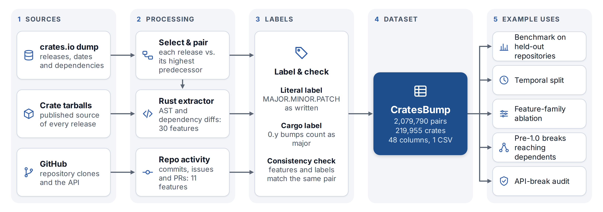
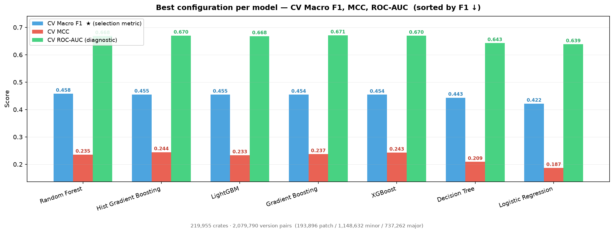

# CratesBump: A Version-Bump Dataset for the Rust Ecosystem

Dataset and tool (**semver-extract**) behind the paper of the same name (release `v1.0.0`). `data/cratesbump.csv.gz` holds **2,079,790 consecutive release pairs from 219,955 crates**, every crates.io crate with at least two releases before 14 September 2026 (99.4% of downloads). Each pair has 41 features (AST change types, dependency changes, complexity, release cadence, GitHub commit and issue/PR activity), its source `repository`, and two labels: the literal MAJOR.MINOR.PATCH bump and Cargo's rule, under which a `0.y` bump is breaking. Code: MIT; dataset: CC BY 4.0.



*Fig. 1 of the paper (a diagram; its counts come from `results/cargo_label_report.json`).*

**Load it** (pandas; no collection needed):

```python
import pandas as pd
df = pd.read_csv("data/cratesbump.csv.gz", keep_default_na=False, na_values=[""])
X = df.drop(columns=["package", "prev_version", "version", "release_type",
                     "release_type_naive", "created_at", "repository"])   # the 41 features
y = df["release_type"]                                      # Cargo label
groups = df["repository"].fillna("crate:" + df["package"])  # hold out whole repositories
```

**Reproduce the paper's tables and numbers** (details in [Reproducing the paper](#reproducing-the-paper); every number is collected in [`results/HEADLINE.md`](results/HEADLINE.md)):

| Paper | Command | Result file |
|---|---|---|
| Dataset section: scope, Table I (columns), Table II (label differences) | `make reproduce-section-3` and `make reproduce-section-5` (`DUMP_DIR=<dump>`) | `results/scope_coverage.json`, `results/cargo_label_report.json`, `results/github_fill_report.json`, [`data/SCHEMA.md`](data/SCHEMA.md) |
| Table III (held-out repositories), held-out crates, temporal split | `make reproduce-section-4` (needs only the CSV) | `results/section_4_*.json` |
| Feature families, dependents, API audit | `make reproduce-section-6 DUMP_DIR=<dump>` (the audit needs Docker) | `results/feature_ablation_rebuilt_cargo_rf.json`, `results/downstream_impact.json`, `results/label_audit/` |
| GitHub-zero breakdown, known bugs, audit disclosures | `make paper-numbers` | `results/paper_numbers.json` |
| All of the above, then `results/HEADLINE.md` | `make reproduce-all DUMP_DIR=<dump>` | |

Rebuilding the dataset itself: `make rebuild-full DUMP_DIR=<dump>` (needs `GITHUB_TOKEN`, about two days). Results with the original model settings are in `results/original_params/`.

The feature design follows Abdalkareem, Chowdhury and Shihab, "A Machine Learning Approach to Determine the Semantic Versioning Type of npm Packages Releases" (arXiv:2204.05929, 2022, <https://arxiv.org/abs/2204.05929>).

---


- **Feature extraction** is written in Rust — it downloads published `.crate` tarballs from crates.io and uses a `syn` AST diff to produce 30 code, dependency, complexity and time features per release pair; `scripts/fill_github_features.py` adds 11 GitHub features: commit activity and commit-message keywords from a clone of each crate's repository, issue/PR activity from the GitHub REST API (GraphQL for repositories too large for REST paging). All **41 features** are populated and trained on in the released dataset; 84.0% of pairs have at least one non-zero GitHub feature; [`data/SCHEMA.md`](data/SCHEMA.md) explains why the other 16.0% are zero. See [`data/DATA_DICTIONARY.md`](data/DATA_DICTIONARY.md) for per-column coverage.
- **The ML pipeline** is written in Python using **scikit-learn**.
- **Trained models are persisted to `models/`** via `joblib` so a single `predict.py` call can classify any crate release.
- **semver-extract**, the tool name used in the paper and in `CITATION.cff`, is this repository's extractor (the `extract` and `batch` binaries built from `src/`) together with the Python dataset-build scripts in `scripts/`.

---

## Quick start

The released dataset, `data/cratesbump.csv.gz`, covers every crates.io crate with at least two releases published before 14 September 2026; you do not need to collect anything to use it.

```bash
# 1. Full setup: Rust toolchain + Python venv + GitHub token prompt
make setup

# 2. Activate the Python environment
source .venv/bin/activate

# 3. Build the Rust extractor binaries
make build

# 4. Train, evaluate and save models on the released dataset
make demo          # ~5 minutes, 25k-row sample, writes nothing
make pipeline      # full dataset, saves models to models/

# 5. Reproduce the paper's benchmark table (held-out repositories, 5 seeds)
make reproduce-section-4

# 6. Predict the bump type for a published version
make predict C=serde V=1.0.200

# 7. Or point at a local crate you're editing — compares it against the given published version
python3 scripts/predict.py serde --local /path/to/serde --prev 1.0.228
```

To rebuild the dataset itself from a crates.io database dump, run `make rebuild-full DUMP_DIR=<dump>` (needs `GITHUB_TOKEN`, about two days); see [Reproducing the paper](#reproducing-the-paper).

---

## Using the released dataset (no collection needed)

The mined dataset ships in [`data/`](data/) — you do **not** need to run the collector to use it:

```bash
# ~5-minute demo: train on a 25k-row sample and print the results table
make demo

# Full training on the released dataset (the default input)
make pipeline

# Or point the pipeline at a dataset file directly
python3 scripts/pipeline.py data/cratesbump.csv.gz
```

| File | Pairs | Notes |
|---|---:|---|
| `data/cratesbump.csv.gz` | **2,079,790** | **Headline dataset.** 219,955 crates (every crates.io crate with at least two releases before 2026-09-14), 48 columns (41 features + `package`, `prev_version`, `version`, `release_type` (Cargo label), `release_type_naive`, `created_at`, `repository`). Capped at 100 pairs per crate and 5,000 per name family. Rebuilt by `make rebuild-full DUMP_DIR=<dump>`. |
| `data/cratesbump_extracted.csv.gz` | 2,421,308 | Uncapped extractor output with naive labels. |
| `data/compliant_dataset_v3_rebuilt_cargo.csv.gz` | 495,602 | Earlier version: crates that reached 1.0 only. |
| `data/compliant_dataset_v2_cargo.csv.gz` | 470,456 | Earlier version; input to the LLM-hybrid experiment (`docs/METHODOLOGY_v2.md` §1.1). |
| `data/compliant_dataset.csv.gz` | 701,349 | Uncapped extraction of an earlier version, kept for provenance. |

The earlier versions predate the fixes described in [`data/README.md`](data/README.md); do not use them for benchmarks. See [`data/README.md`](data/README.md), [`data/DATA_DICTIONARY.md`](data/DATA_DICTIONARY.md) and [`data/SCHEMA.md`](data/SCHEMA.md) for schema, provenance, and per-column coverage.

---

## What this does

1. **Collects data** by downloading `.crate` tarballs from crates.io and querying the GitHub API — extracting 41 features for each release pair.
2. **Trains seven classifiers** (XGBoost, LightGBM, Hist Gradient Boosting, Random Forest, Gradient Boosting, Logistic Regression, Decision Tree) as multi-class models over major / minor / patch, alongside two trivial baselines (always-majority and stratified-random).
3. **Evaluates** them with macro-averaged F1 score (F1) and Matthews Correlation Coefficient (MCC), which treat all three classes equally regardless of how imbalanced the data is. The paper's numbers (`make reproduce-section-4`, `scripts/evaluate.py`) hold out 20 % of the source repositories, so no repository, and so no crate, appears in both train and test; `make pipeline` (`scripts/pipeline.py`) holds out 20 % of the crates.
4. **Saves trained models** to `models/` using `joblib` so they can be reloaded without retraining.
5. **Predicts** the bump type (major / minor / patch) for any `<crate> <version>` pair by pulling live data from crates.io, extracting features, and running all seven classifiers.

---

## Directory structure

```
CratesBump/
│
├── Makefile              ->  All workflows: setup, build, collect, train, reproduce the paper
├── rust-toolchain.toml   ->  Pins the Rust toolchain channel
├── requirements.txt      ->  Python dependencies (scikit-learn, imbalanced-learn, …)
├── Cargo.toml            ->  Rust package manifest + dependencies
├── CITATION.cff          ->  How to cite the dataset and tool
├── LICENSE               ->  MIT (code); data/LICENSE is CC BY 4.0 (dataset)
├── SUMMARY.md            ->  One-page summary of the paper's numbers
│
├── src/                  ->  Rust feature extractor
│   ├── lib.rs            ->  Library root; declares all modules
│   ├── token.rs          ->  Reader for the optional .token GitHub token file
│   ├── features.rs       ->  The feature struct (41 features + three Cargo signals)
│   ├── data.rs           ->  CSV writing
│   ├── extractor/
│   │   ├── mod.rs        ->  Pairing rule (plan_pairs), tarball download, per-pair extraction
│   │   ├── api.rs        ->  HTTP clients: crates.io versions/tarballs, GitHub issues/PRs/commits
│   │   ├── diff.rs       ->  Filesystem diff helpers: file-set comparison, comment-line diff
│   │   └── ast.rs        ->  Rust AST analysis via syn: functions, complexity,
│   │                         logic blocks, globals, comments, dependency diff
│   └── bin/
│       ├── extract.rs    ->  Single-crate extractor CLI
│       └── batch.rs      ->  Bulk extractor: crate list or top-N crates, parallel workers
│
├── scripts/              ->  Python: dataset build, ML pipeline, analyses
│   ├── build_crate_list.py, build_snapshot_manifest.py, merge_crate_csvs.py,
│   │   label_pairs_cargo.py, fill_github_features.py   ->  dataset build (make rebuild-full)
│   ├── pipeline.py       ->  Train & evaluate the seven classifiers, save models to models/
│   ├── evaluate.py       ->  Multi-seed held-out-repository / temporal evaluation (paper Table)
│   ├── tune.py, upgrade_defaults.py  ->  Hyperparameter search; promote results to pipeline.py
│   ├── predict.py        ->  Classify one crate release with the saved models
│   ├── feature_ablation.py, label_sanity_check.py, downstream_impact.py,
│   │   label_audit_cargo_semver_checks.py, audit_flag_context.py  ->  analyses (make reproduce-section-6)
│   ├── paper_numbers.py  ->  GitHub-zero breakdown, known bugs, audit disclosures (make paper-numbers)
│   ├── write_headline.py ->  Writes results/HEADLINE.md from the result files
│   └── jev_optimized.py, llm_clients.py, jev_summarize.py  ->  LLM-hybrid experiment (earlier version)
│
├── data/                 ->  Released datasets + README.md / DATA_DICTIONARY.md / SCHEMA.md / LICENSE
├── docs/METHODOLOGY_v2.md ->  Data-collection and evaluation protocol
├── docs/figures/workflow.png ->  Fig. 1 of the paper
├── docker/
│   └── audit.Dockerfile  ->  Sandbox image for the cargo-semver-checks label audit
├── jev_cache/            ->  Cached LLM responses for the LLM-hybrid experiment
│
├── results/              ->  Result files behind the paper (see results/HEADLINE.md)
│   ├── HEADLINE.md                 ->  Every headline number, generated by make headline
│   ├── paper_numbers.json          ->  Written by make paper-numbers
│   ├── section_4_*.json            ->  Held-out repositories / crates, temporal split
│   ├── feature_ablation_rebuilt_cargo_rf.json, downstream_impact.json,
│   │   label_sanity_rebuilt_cargo*, label_audit/  ->  analyses and the hand-checked API audit
│   ├── cargo_label_report.json, extraction_report.json, github_fill_report.json,
│   │   scope_coverage.json, crates_all.txt, crates_all_repos.csv  ->  build reports, crate list, repository map
│   ├── original_params/, params_tune160k/  ->  same runs with earlier hyperparameters
│   ├── tuning_results.json + tuning_*.png  ->  make tune output
│   └── jev_v2cargo_*                ->  LLM-hybrid runs (earlier version)
│
├── crate_csvs/           ->  Per-crate CSVs written by make extract / make batch / predict.py (gitignored)
├── models/               ->  Saved classifiers + metadata.json written by make pipeline (gitignored)
└── predictions_cache.json ->  Cached predict.py results (gitignored)
```

---

## Setup in detail

### Prerequisites

| Tool | Tested version | Install |
|------|----------------|---------|
| `rustup` | any | `curl --proto '=https' --tlsv1.2 -sSf https://sh.rustup.rs \| sh` |
| `python3` | 3.12.3 |  |
| `tar` | any | pre-installed on Linux/macOS |
| `libomp` *(macOS only)* | any | `brew install libomp` — required by `xgboost`/`lightgbm`; without it the pipeline still runs on the 5 scikit-learn models |

### `make setup`

Running `make setup` performs three steps automatically:

1. **Rust toolchain** — installs the `stable` channel pinned in `rust-toolchain.toml` and sets it as the directory override.
2. **Python virtual environment** — creates `.venv/` and installs all packages from `requirements.txt`.
3. **GitHub token prompt** *(optional)* — interactively asks for a GitHub personal access token and saves it to `.token`. You do not need one to use the released dataset or to run the base extractor. The GitHub features in the released dataset were computed by `scripts/fill_github_features.py` (with the crawler in `scripts/enrich_github.py`), which reads its token(s) from the `GITHUB_TOKEN` environment variable. To generate a token:
  - Go to https://github.com/settings/tokens
  - Click **Generate new token** → **Tokens (classic)**
  - Select **public_repo** (read-only access to public repositories is enough)
  - Copy the token; you can also write it straight to `.token`:
  ```
  ghp_your_token_here
  ```


After `make setup` finishes, activate the venv in your shell by running:

```bash
source .venv/bin/activate
```
---

## Collecting data

For each version pair the extractor downloads two `.crate` tarballs from
`static.crates.io`, unpacks them, and computes the features from the sources.

### Single crate

```bash
make extract C=serde

# Equivalent manual command with more options:
./target/release/extract serde --output crate_csvs/serde.csv
```

### Bulk (a custom sample: the top N crates by downloads)

`make batch` collects your own sample from the live crates.io API. The released dataset is not built this way: `make rebuild-full DUMP_DIR=<dump>` extracts every crate with at least two releases before 14 September 2026 from a crates.io database dump (see [Reproducing the paper](#reproducing-the-paper)).

```bash
# Default: top 1000 crates, 6 workers (~3–6 hours)
make batch

# Override default:
make batch COUNT=500 WORKERS=4

# Equivalent manual command:
./target/release/batch \
  --count 1000 --workers 6 \
  --crate-dir crate_csvs/
```

Progress is printed to stderr — if interrupted, re-running skips crates whose csv already exists in `crate_csvs/`.

---

## Dataset

The released dataset covers:

| | **cratesbump (headline)** |
|---|---:|
| **Crates** | **219,955** |
| **Version pairs** | **2,079,790** |
| **Trained features** | 41 |
| **patch** releases (Cargo label) | 9.32 % |
| **minor** releases (Cargo label) | 55.23 % |
| **major** releases (Cargo label) | **35.45 %** |

`data/cratesbump.csv.gz` is the headline dataset: 2,079,790 release pairs from 219,955 crates, covering every crates.io crate with at least two non-yanked releases published before 2026-09-14 (225,799 of 349,979 crates, 99.4% of all downloads; 84% of them never had a stable 1.0 release). It is built from the crates.io database dump of 2026-10-12 (crate selection, version list, predecessors, timestamps, dependency graph). `scripts/build_crate_list.py` selects the crates and `scripts/build_snapshot_manifest.py` lists their non-yanked versions published before 2026-09-14T00:00Z; the Rust extractor (`src/bin/batch.rs`, one version for every crate) pairs and diffs them from the published `.crate` tarballs; `scripts/label_pairs_cargo.py --check-rdtd` rebuilds every pair's predecessor from the dump, keeps a row only if the extractor's naive label and its `rdtd` match that predecessor, writes the Cargo label (`release_type`) and the literal MAJOR.MINOR.PATCH label (`release_type_naive`), fills `created_at` and `repository`, and caps the file at 100 pairs per crate and 5,000 per name family (uniform random sample, seed 42); `scripts/fill_github_features.py` then computes the 11 GitHub features for every row. Reproduce with `make rebuild-full DUMP_DIR=<dump>` and then `make reproduce-section-4`. See [`data/README.md`](data/README.md) for provenance and [`SUMMARY.md`](SUMMARY.md) for the headline numbers.

The external label audit (`make reproduce-section-6 DUMP_DIR=<dump>`) builds randomly sampled crates with `cargo-semver-checks`, which runs their build scripts. It therefore runs every build in a Docker sandbox (non-root, no capabilities, no network during builds, a fresh cargo cache per pair); build the image once with `docker build -t cratesbump-audit:0.51.0 -f docker/audit.Dockerfile docker/`.

---

## Running the ML pipeline

```bash
# Activate the venv first (if you haven't already)
source .venv/bin/activate

# Train on the released dataset (DATA=data/cratesbump.csv.gz), evaluate, save models
make pipeline

# Or train on the per-crate CSVs you collected with make batch / make extract
python3 scripts/pipeline.py --save-models

# Smoke-test on synthetic data (no CSV needed)
python3 scripts/pipeline.py --synthetic
```

Each run trains all seven classifiers twice — once with SMOTE (as in the paper), once with a class-weighted loss as an alternative. Models are saved from the SMOTE run by default. `make pipeline` holds out 20 % of the crates; the paper's held-out-repository numbers come from `make reproduce-section-4`.

```
results/auc_table.png          -> SMOTE run
results/auc_table_weighted.png -> class-weighted run
```

To save models from the weighted run instead:
```bash
python3 scripts/pipeline.py --save-models --save-from weighted
```

### Handling class imbalance

The headline dataset is **9.3 % patch / 55.2 % minor / 35.4 % major** under the Cargo label, against 64.3 % / 32.9 % / 2.8 % under the literal MAJOR.MINOR.PATCH label: Cargo treats the leftmost non-zero component as the breaking one, so pre-1.0 patch-position bumps become minor and minor-position bumps become major, and most pairs are pre-1.0. Without any correction, a model that always predicts "minor" would score 55 % accuracy while never predicting the 9 % of patch releases. Both strategies below try to counter the residual imbalance:

**SMOTE** *(Synthetic Minority Over-sampling Technique)*
Creates new synthetic training examples for the minority classes by interpolating between real ones. Patch releases are the rarest class under the Cargo label, so SMOTE generates synthetic patch (and major) examples until the classes are balanced. The downside: the synthetic feature vectors are fractional (e.g. "3.7 functions added") and such things never appear at inference time, which can blur the decision boundary.

**Class-weighted loss**
Leaves the training data completely unchanged. Instead, each sample is given a weight inversely proportional to its class frequency, so the model’s loss function treats a wrong prediction on a patch release (the rarest class) as more costly than a wrong prediction on a minor one. This rescales the penalty instead of generating new data.

### Using tuned hyperparameters

By default the pipeline uses the values stored in `DEFAULT_PARAMS` in `pipeline.py`. These are not library defaults: they come from `scripts/tune.py` on the headline dataset, a 30-configuration random search per model with 3-fold cross-validation grouped by source repository, on a sample of 500,016 pairs from 32,760 whole repositories (`results/tuning_results.json`); per model, the candidate with the highest cross-validated macro-F1 among the search's best, the settings of an earlier 160,002-pair search and the original defaults was adopted. There are two ways to use hyperparameters from a new `make tune` run:

**Option A** (uses tuned params for this run only):
```bash
make pipeline BEST_PARAMS=1
```
This reads `results/tuning_results.json` at runtime and overrides the defaults. Nothing in `pipeline.py` is changed.

**Option B — promote to permanent defaults** 
```bash
make tune        # find the best hyperparameters
make upgrade     # write them into DEFAULT_PARAMS in pipeline.py
make pipeline    # now uses the tuned values automatically, no flag needed
```
`make upgrade` rewrites the `DEFAULT_PARAMS` block in `pipeline.py` in-place.

> **Which metric decides "best"?** `make tune` selects the winning configuration by **Cross-Validation (CV) Macro F1**. The other metrics are tracked for diagnostics but not used for selection.

## Evaluation results

After training, `make pipeline` saves two evaluation tables as images, `results/auc_table.png` (SMOTE) and `results/auc_table_weighted.png` (class-weighted), each with **five columns** per classifier. The numbers reported in the paper (held-out repositories, five seeds, macro-F1 0.447–0.459 for the tree ensembles) are in [`results/HEADLINE.md`](results/HEADLINE.md), generated from the result files by `make headline`.

### Understanding the five metrics

The headline dataset is **9.3 % patch / 55.2 % minor / 35.4 % major** under the Cargo label, skewed enough that plain **accuracy** is unreliable (an "always minor" baseline hits 55 % accuracy without learning anything). We therefore report five metrics:

---

#### Macro F1 *(higher is better, 0 -> 1)*

**F1** is the harmonic mean of precision and recall for a single class:

```
Precision = true positives / (true positives + false positives)
Recall    = true positives / (true positives + false negatives)
F1        = 2 × (Precision × Recall) / (Precision + Recall)
```

**Macro** averaging computes F1 separately for each class (major, minor, patch) and then takes the **unweighted average** — so patch (9 % of the headline dataset) counts exactly as much as minor (55 %). A model that ignores the small "patch" class gets punished for it.

---

#### MCC — Matthews Correlation Coefficient *(higher is better, −1 -> 1)*

MCC treats the confusion matrix as a whole. For multi-class problems it generalises to:

```
MCC = (TP × TN − FP × FN) / sqrt((TP+FP)(TP+FN)(TN+FP)(TN+FN))
      ... extended across all class pairs
```

**What it answers:** *"Is the model actually learning, or just exploiting class imbalance?"*

- `1.0` = perfect classifier
- `0.0` = no better than a random baseline
- `-1.0` = perfectly wrong (every prediction is the wrong class)
- A model that always predicts "patch" scores near **0.0** MCC,

MCC is a stricter sanity check than F1.
---

#### Maj AUC / Min AUC / Pat AUC — Per-class ROC-AUC *(higher is better, 0.5 -> 1)*

**ROC** (Receiver Operating Characteristic) plots **True Positive Rate vs False Positive Rate** as the classification threshold slides from 0 -> 1.  
**AUC** is the Area Under the Curve.

Each column uses **one-vs-rest**: for "Maj AUC" the classifier asks *"is this a major bump?"* vs everything else.

**What it answers:** *"How well can the model separate this class from the rest?"*

- `1.0` = perfect separation
- `0.5` = coin flip


**Some Notes**
- If Macro F1 is low but all AUCs are high -> the switching imbalance strategy is not good.
- If Maj AUC is near 0.6 -> the features carry almost no signal for "major" bumps; more data or better features are needed
- If Maj AUC is high but Macro F1 is low -> the model knows what a major bump looks like but the decision boundary isn't calibrated well

---

## Hyperparameter tuning

```bash
# Search over all seven classifiers with default settings (a 500,000-pair sample of
# whole repositories, 5 parallel fits; about 5 hours)
make tune

# More iterations for a thorough search
make tune N_ITER=50 TUNE_CV=5

# Smoke-test on synthetic data (completes in seconds)
python3 scripts/tune.py --synthetic --n-iter 5
```

- `results/tuning_results.png` — overview bar chart comparing CV F1, MCC, and ROC-AUC across all models
- `results/tuning_table.png` — standalone summary table (model · CV F1 · CV MCC · CV ROC-AUC · Test MCC · Test ROC-AUC · best params)
- `results/tuning_<Model>.png` × 7 — per-model line plot showing F1 and MCC across every configuration tried
- `results/tuning_results.json` — best params per model

The best params are also printed to the terminal. See the [Using tuned hyperparameters](#using-tuned-hyperparameters) section for how to apply them.



---

## Prediction pipeline

Once models are trained and saved, `predict.py` classifies any crate release on demand.

```bash
# After training:
make pipeline

# Predict the bump type for serde 1.0.200
make predict C=serde V=1.0.200

# Equivalent manual call:
python3 scripts/predict.py serde 1.0.200

# Use a specific classifier instead of all seven
python3 scripts/predict.py serde 1.0.200 --model "XGBoost"
python3 scripts/predict.py serde 1.0.200 --model "LightGBM"
python3 scripts/predict.py serde 1.0.200 --model "Hist Gradient Boosting"
python3 scripts/predict.py serde 1.0.200 --model "Random Forest"
python3 scripts/predict.py serde 1.0.200 --model "Gradient Boosting"
python3 scripts/predict.py serde 1.0.200 --model "Logistic Regression"
python3 scripts/predict.py serde 1.0.200 --model "Decision Tree"

# Skip cache and always run full inference
python3 scripts/predict.py serde 1.0.200 --no-cache
```

### Predicting from a local working directory

You can also point `predict.py` at a local crate directory (e.g. one you are actively editing) and ask what semver bump it would deserve compared to a published baseline:

```bash
# Compare your local edits against the published 1.0.228 tarball
python3 scripts/predict.py serde --local /path/to/serde --prev 1.0.228

# --prev is optional: if omitted it reads the version from the local Cargo.toml
python3 scripts/predict.py serde --local /path/to/serde
```

The Rust binary downloads the `--prev` tarball from crates.io, diffs it against your local directory, and runs the classifiers on the resulting feature vector. If the two trees are identical the tool exits early with a "no differences detected" message instead of running inference.

### How prediction works 
We have three paths:

1. **Ground truth known** — if the version is already in `crate_csvs/<crate>.csv`, the label is returned immediately (no inference needed). The CSV is also used when you run `python3 scripts/pipeline.py` without a dataset argument.
2. **Cached prediction** — if this exact crate + version was classified before, the saved result from `predictions_cache.json` is shown instantly.
3. **Full inference** — extracts features (if `crate_csvs/<crate>.csv` doesn't exist yet, the `extract` binary fetches all version pairs from crates.io and saves the CSV), runs all seven classifiers, and caches the result for next time.

Pass `--no-cache` to skip paths 1 and 2 and always run full inference.

Example output:

```
Predicting bump type for  serde 1.0.200 (vs 1.0.199)
────────────────────────────────────────────────────────────────
Classifier              Prediction   major   minor   patch
────────────────────────────────────────────────────────────────
XGBoost                      patch   0.010   0.090   0.900
LightGBM                     patch   0.010   0.095   0.895
Hist Gradient Boosting       patch   0.015   0.085   0.900
Random Forest                patch   0.030   0.110   0.860
Gradient Boosting            patch   0.020   0.090   0.890
Logistic Regression          patch   0.050   0.140   0.810
Decision Tree                patch   0.000   0.000   1.000
────────────────────────────────────────────────────────────────
```

---

## The 41 features

Each release pair (e.g. `1.2.3 -> 1.2.4`) produces one row with these features, split across six dimensions. **The headline dataset populates and trains on all 41 columns.** The 11 GitHub columns (`tcm, tau, nbf, kwm, kwp, kwb, aml, poi, pci, popr, pcpr`) are all zero for 16.0% of pairs, mostly because no GitHub data exists for them (see [`data/SCHEMA.md`](data/SCHEMA.md)); 84.0% of pairs have at least one non-zero GitHub feature. See [`data/DATA_DICTIONARY.md`](data/DATA_DICTIONARY.md) for exact per-column coverage.

### 1. Change-type features (20)
Describe *what* changed in the source code between two releases.

| CSV column | Full name | What it counts |
|------------|-----------|---------------|
| `arf` | Added Rust Files | Number of `.rs` source files **added** |
| `mrf` | Modified Rust Files | Number of `.rs` source files **modified** |
| `drf` | Deleted Rust Files | Number of `.rs` source files **deleted** |
| `anrf` | Added Non-Rust Files | Non-`.rs` files added (docs, configs, etc.) |
| `dnrf` | Deleted Non-Rust Files | Non-`.rs` files deleted |
| `mnrf` | Modified Non-Rust Files | Non-`.rs` files modified |
| `adm` | Added Methods | Functions / methods **added** |
| `dem` | Deleted Methods | Functions / methods **deleted** |
| `mom` | Moved Methods | Functions moved between modules (identical body, different module path) |
| `mnc` | Method Name Changes | Functions renamed (identical body, same module, different name) |
| `mpc` | Method Parameter Changes | Functions whose parameter list changed |
| `mpd` | Method Parameter Deletions | Functions whose parameter list shrank |
| `mla` | Logic Blocks Added | `if` / `for` / `while` / `match` arms **added** |
| `mlm` | Logic Blocks Moved | Change in logic-block count inside functions kept under the same name (sum of absolute deltas) |
| `mld` | Logic Blocks Deleted | `if` / `for` / `while` / `match` arms **deleted** |
| `gva` | Global Variables Added | `static` / `const` items **added** |
| `gvd` | Global Variables Deleted | `static` / `const` items **deleted** |
| `icc` | Inserted Comment Lines | Comment lines **added** |
| `dcc` | Deleted Comment Lines | Comment lines **deleted** |
| `mcc` | Modified Comment Lines | Comment lines **modified** (`min(added, deleted)` as a proxy) |

### 2. Dependency features (4)
Changes to the `Cargo.toml` dependency list.

| CSV column | Full name | What it counts |
|------------|-----------|---------------|
| `tcct` | Total Changes Touching Cargo.Toml | 1 if a dependency section of `Cargo.toml` changed between the two releases, else 0 (the version bump alone does not count) |
| `pa` | Packages Added | Dependencies **added** to `[dependencies]`, `[dev-dependencies]` or `[build-dependencies]` |
| `pd` | Packages Deleted | Dependencies **removed** from `[dependencies]`, `[dev-dependencies]` or `[build-dependencies]` |
| `pu` | Packages Updated | Dependencies whose version requirement **changed** |

### 3. Complexity / code size features (5)
How much the code size and complexity changed between releases.

| CSV column | Full name | What it counts |
|------------|-----------|---------------|
| `acycd` | Average Cyclomatic Complexity Delta | Change in **average** cyclomatic complexity across all functions |
| `clcrd` | Code Lines Change Rust Delta | Net change in total lines of code (added minus deleted) |
| `cycd` | Cyclomatic Complexity Delta | Change in **total** cyclomatic complexity (absolute value) |
| `la` | Lines Added | Total lines of code **added** |
| `ld` | Lines Deleted | Total lines of code **deleted** |

> **Cyclomatic complexity** measures how many independent paths exist through a function. Each `if`, `while`, `for`, `loop`, `match` arm, `&&`, or `||` adds 1 to the count (every function starts at 1). Higher complexity = harder to test.

### 4. Time feature (1)

| CSV column | Full name | What it counts |
|------------|-----------|---------------|
| `rdtd` | Release Date Time Delta | Number of **days** elapsed since the previous release |

### 5. GitHub commit features (7)
Commits in the release window (after the previous release, up to and including the current one), read from a clone of the crate's repository (`git log --all --no-merges`). Zero when there is no GitHub data for the pair or nothing happened in the window (see [`data/SCHEMA.md`](data/SCHEMA.md)).

| CSV column | Full name | What it counts |
|------------|-----------|---------------|
| `tcm` | Total Commits | Commits in the release window |
| `tau` | Total Authors | **Unique** commit authors in the window |
| `nbf` | Number of Bug-Fixing commits | Commits whose subject line contains a word starting with `fix`, `bug`, `defect`, `error` or `issue` |
| `kwm` | Keyword Major | Commits whose subject line contains `major` |
| `kwp` | Keyword Patch | Commits whose subject line contains `patch` |
| `kwb` | Keyword Break | Commits whose subject line contains `break` |
| `aml` | Average Subject Length | Average number of characters in commit subjects (first line of the message) |

### 6. GitHub issue/PR features (4)
Counts (not percentages) over the same window, from the repository's issue and pull-request lists (GitHub GraphQL and REST APIs). Zero when there is no GitHub data for the pair or nothing happened in the window (see [`data/SCHEMA.md`](data/SCHEMA.md)).

| CSV column | Full name | What it counts |
|------------|-----------|---------------|
| `poi` | Opened Issues | Issues **opened** during the window |
| `pci` | Closed Issues | Issues **closed** during the window |
| `popr` | Opened Pull Requests | Pull requests **opened** during the window |
| `pcpr` | Closed Pull Requests | Pull requests **closed** during the window (merged or not) |

---

## Reproducing the paper

Every table and number in the paper is generated from the files in `results/` (collected in [`results/HEADLINE.md`](results/HEADLINE.md)); the Makefile targets below regenerate them (exceptions below the table). Their numbers follow the companion repository, not the paper's section numbers. Targets marked with `DUMP_DIR` need a local copy of the crates.io database dump (<https://crates.io/data-access>); the paper used the dump of 2026-10-12.

| Command | What it regenerates | Needs |
|---|---|---|
| `make reproduce-section-3 DUMP_DIR=<dump>` | Crate list, repository map and scope coverage (`results/crates_all*.{txt,csv}`, `results/scope_coverage.json`) | dump |
| `make rebuild-full DUMP_DIR=<dump>` | The dataset itself: extraction of every in-scope crate, then `reproduce-section-5` | dump, network, `GITHUB_TOKEN`; about two days |
| `make reproduce-section-4` | Benchmark on held-out repositories (5 seeds), held-out crates, temporal split (`results/section_4_*.json`) | the committed `data/cratesbump.csv.gz` only |
| `make reproduce-section-5 DUMP_DIR=<dump>` | Predecessors, Cargo labels, caps, `repository`, GitHub features (`results/cargo_label_report.json`, `results/github_fill_report.json`) | dump, `GITHUB_TOKEN` |
| `make reproduce-section-6 DUMP_DIR=<dump>` | Feature ablation, label-consistency probe, dependents of pre-1.0 breaking releases, `cargo-semver-checks` audit | dump, Docker (audit image: `docker build -t cratesbump-audit:0.51.0 -f docker/audit.Dockerfile docker/`) |
| `make paper-numbers [DUMP_DIR=<dump>]` | GitHub-zero breakdown, the two known GitHub-step bugs, audit disclosures (unchecked pairs, checkable share by year, `0.y.z` share, rates without pre-releases, combined rate) in `results/paper_numbers.json` | the committed files; the dump only for the audit's binary/macro split |
| `make reproduce-all DUMP_DIR=<dump>` | Sections 4–6, `make paper-numbers`, then `make headline` | as above |
| `make headline` | `results/HEADLINE.md` from the result files | nothing |

Three GitHub-zero details in the paper come from the crawl caches (`enrich_cache/`, not committed, as they hold every repository's commit list): the split of the "nothing in the window" pairs into histories that miss the release (1.4%) and quick re-releases (1.5%), the exact count of pairs in repositories that could not be cloned (82,909; `make paper-numbers` gives 83,034 from `results/github_fill_report.json`, also 4.0%), and the at most 49 repositories hit by the unchecked `git log` bug. `results/paper_numbers.json` gives a CSV-only approximation of the split. The audit's eight feature-conflict build failures are found by a log pattern; `make paper-numbers` lists them.

The same runs with the hyperparameters used before re-tuning are kept in `results/original_params/` and `results/params_tune160k/`. The audit's hand-review verdicts are in `results/label_audit/hand_review.csv`. The methodology is described in [`docs/METHODOLOGY_v2.md`](docs/METHODOLOGY_v2.md).

The few-shot LLM hybrid on an earlier version (`docs/METHODOLOGY_v2.md` §1.1) is reproduced from cached responses with `make jev-sweep` (see [`jev_cache/README.md`](jev_cache/README.md)).

---

## License and citation

The code is released under the MIT License ([`LICENSE`](LICENSE)); the dataset files in `data/` under CC BY 4.0 ([`data/LICENSE`](data/LICENSE)). Please cite the dataset and tool as described in [`CITATION.cff`](CITATION.cff).
